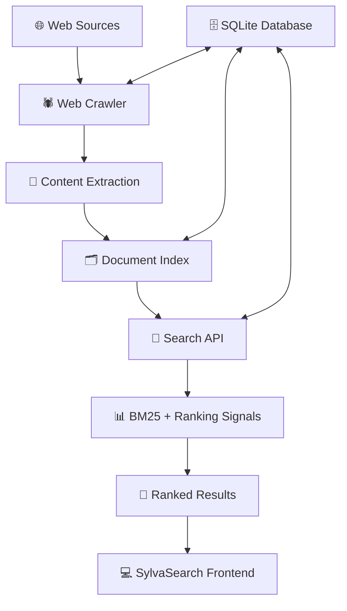

<div align="center">

# 🌿 SylvaSearch

### Search smarter. Discover more.

An independent search engine built around web crawling, indexing, and relevance-based ranking.

<p>
  <a href="#-features">Features</a> •
  <a href="#-architecture">Architecture</a> •
  <a href="#-quick-start">Quick Start</a> •
  <a href="#-api">API</a> •
  <a href="#-roadmap">Roadmap</a>
</p>


**[Explore the Repository](../../) · [Report a Bug](../../issues) · [Request a Feature](../../issues)**

</div>

---

## 📖 About

**SylvaSearch** is an independent search engine project designed to help users discover relevant information through a searchable web index.

It combines web crawling, document indexing, ranking algorithms, and a web interface to create a complete search experience.

The goal is simple: **build a search engine where relevance matters.**

## ✨ Features

<details open>
<summary><b>🔍 Search & Ranking</b></summary>

- 🔎 Full-text search across indexed web documents
- 📊 BM25-based relevance scoring
- 🏆 PageRank-inspired authority signals
- 🧠 Query-aware result ranking
- 📄 Paginated results for easier navigation

</details>

<details>
<summary><b>🕷️ Web Crawling & Indexing</b></summary>

- 🌐 Discover and retrieve web pages
- 🗂️ Store searchable document information
- 🔄 Maintain a local search corpus
- 🛡️ Handle crawling failures and retries
- 🤖 Support responsible crawling practices

</details>

<details>
<summary><b>🖼️ Search Experience</b></summary>

- 🖼️ Image search with relevance filtering
- 💡 Dynamic search suggestions
- 📑 Organized search result pages
- ↔️ Previous and Next pagination
- ⚡ Frontend connected to the search API

</details>

> Features may evolve during development. Check the current implementation before assuming every capability is production-ready.

## 🏗️ Architecture



### 🧰 Technology Stack

| Component | Technology | Purpose |
|---|---|---|
| Backend | Python | Search and crawling logic |
| API | FastAPI | HTTP endpoints |
| Database | SQLite | Persistent document and index storage |
| Search ranking | BM25 and PageRank signals | Rank search results |
| Frontend | Vite-based application | Search interface |

## 🚀 Quick Start

### Prerequisites

- Python installed
- Node.js and npm installed
- Git installed

### 1. Clone the repository

```bash
git clone <YOUR_REPOSITORY_URL>
cd sylvasearch
```

### 2. Start the backend

Open a terminal:

```powershell
cd backend
python -m venv .venv
.\.venv\Scripts\Activate.ps1
pip install -r requirements.txt
```

Start the API:

```powershell
uvicorn app.main:app --reload
```

Explore the API documentation:

**http://127.0.0.1:8000/docs**

### 3. Start the frontend

Open another terminal from the project root:

```powershell
cd frontend
npm install
npm run dev
```

Open the local address printed by Vite, commonly:

**http://localhost:5173**

> ⚠️ These commands assume your repository contains `backend/requirements.txt`, `app.main:app`, and a `frontend/` directory. Adjust them to match your actual project structure.

## 🔌 API

Once the backend is running, FastAPI provides interactive API documentation at `/docs`.

Example request using Python:

```python
import requests

response = requests.get(
    "http://127.0.0.1:8000/search",
    params={"q": "Python"},
    timeout=10,
)

response.raise_for_status()
print(response.json())
```

> The example assumes your API exposes `GET /search` with a `q` parameter. Check `/docs` for the actual endpoint, parameters, and response format.

## 🧪 Testing

Run the backend test suite from the backend directory:

```powershell
python -m pytest tests/ -v
```

Tests should cover areas such as:

- Search API behavior
- Crawling and extraction
- Ranking relevance
- Image relevance
- Database recovery
- Pagination

## 🗺️ Roadmap

- [x] Core search API
- [x] BM25-based search ranking
- [x] Persistent search database
- [x] Paginated search results
- [x] Image relevance filtering
- [ ] Broader search-quality evaluation
- [ ] Improved indexing coverage
- [ ] Additional performance optimization
- [ ] Expanded automated frontend testing

*Roadmap checkboxes should reflect the actual state of the latest code.*

## 🤝 Contributing

Contributions, suggestions, and bug reports are welcome!

1. Fork the repository.
2. Create a feature branch.
3. Make your changes.
4. Run the relevant tests.
5. Open a pull request describing your changes.

For bugs or feature ideas, use the repository's **Issues** tab.

## 🔐 Responsible Crawling

SylvaSearch is designed to retrieve and index web content responsibly.

- Respect website crawling policies and applicable `robots.txt` rules.
- Use reasonable request rates.
- Handle errors and retries safely.
- Respect copyright, privacy, and applicable website terms.

## 📜 License

Add your chosen open-source license here. Until a license is included, users should not assume the repository is available for unrestricted reuse.

---

<div align="center">

### 🌿 Built with curiosity. Improved with every search.

**SylvaSearch** — An independent search engine project.

[⬆ Back to Top](#-sylvasearch)

</div>
